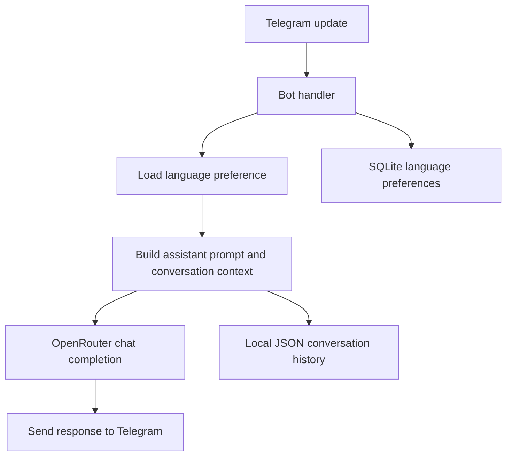

# ClarityBot

ClarityBot is a Telegram chatbot prototype built with Python and python-telegram-bot. It connects to an OpenRouter-compatible chat model and supports English and Indonesian language preferences.

> **Status:** Experimental personal project. Review the limitations below before deploying it for other users.

## What is implemented

- Telegram bot handlers built with python-telegram-bot 20.x
- English and Indonesian language selection through inline buttons
- Per-user language preference storage using SQLite
- Chat-completion requests through the OpenRouter API
- Optional system-prompt file
- Per-user message throttling in the running process
- Short conversation history persisted in a local JSON file
- Environment-based configuration for Telegram and model-provider credentials

## Request flow



## Stack

- Python
- python-telegram-bot 20.3
- Requests
- python-dotenv
- Flask (used by the keep-alive entrypoint)
- SQLite

## Configuration

Create a local `.env` file. Do not commit it.

```env
TELEGRAM_TOKEN=your_telegram_bot_token
OPENROUTER_KEY=your_openrouter_api_key
```

The bot reads these values from environment variables. Keep provider keys and bot tokens out of source control, logs, screenshots, and issue reports.

## Run locally

Use Python 3.10 or newer.

```bash
git clone https://github.com/Kavyanjali07/ClarityBot.git
cd ClarityBot

python -m venv .venv
source .venv/bin/activate

python -m pip install --upgrade pip
pip install -r requirements.txt

python main.py
```

On Windows, activate the virtual environment with:

```powershell
.venv\Scripts\Activate.ps1
```

## Commands and interaction

- `/start` — start the bot and select a language
- `/setlang en` — choose English
- `/setlang id` — choose Indonesian

The available commands depend on the handlers registered in the current source.

## Important limitations

This is a prototype, not a hardened multi-user service.

- Message rate limits are held in process memory and reset when the bot restarts.
- Conversation history is stored in a local JSON file; this is not a scalable or strongly isolated persistence layer.
- The keep-alive Flask pattern is deployment-specific and is not a substitute for health checks and process supervision.
- Provider availability, model behaviour, latency, and cost depend on the configured OpenRouter model.
- No claim is made that the bot provides production-grade privacy, moderation, uptime, or data retention controls.

Before public deployment, add persistent rate limiting, robust exception handling and retries, bounded conversation storage, privacy-conscious retention controls, tests, and deployment documentation.

## Project lineage and attribution

This repository has an earlier project history that references work by **Jail Idea** and the WormGPT project. Preserve the original copyright and license notices for any code retained from upstream. The current ClarityBot configuration is intended to be a helpful bilingual assistant, not an unsafe-mode chatbot. Review the upstream license and retained files before redistribution.

## Author

Kavyanjali · [GitHub](https://github.com/Kavyanjali07) · [LinkedIn](https://www.linkedin.com/in/kavyanjali07)
